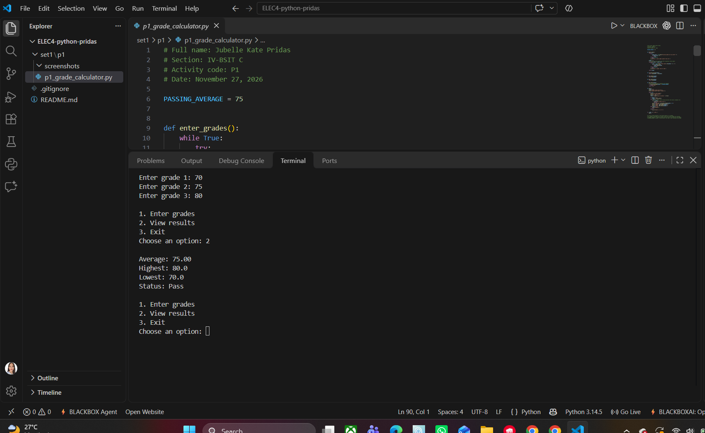
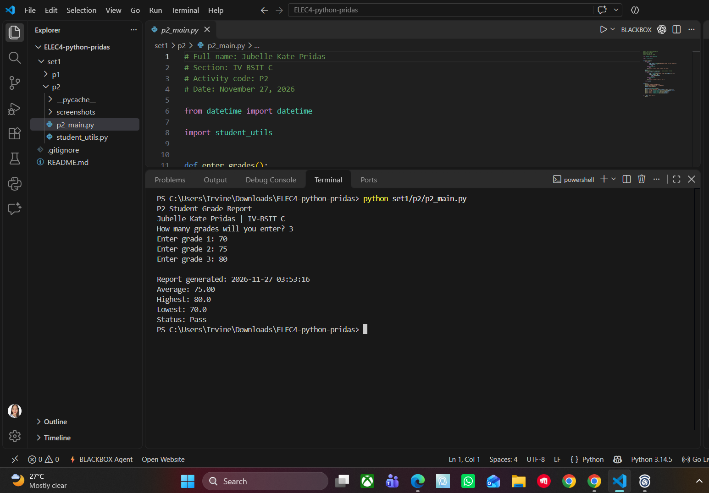
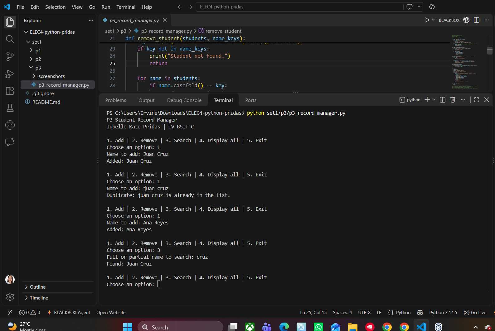
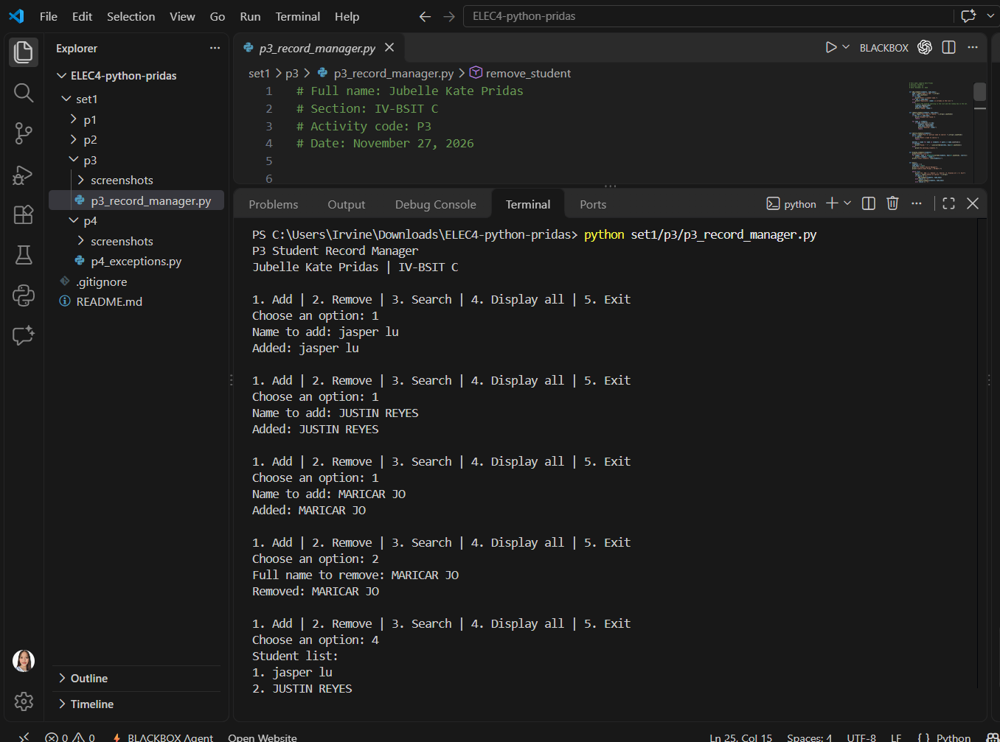
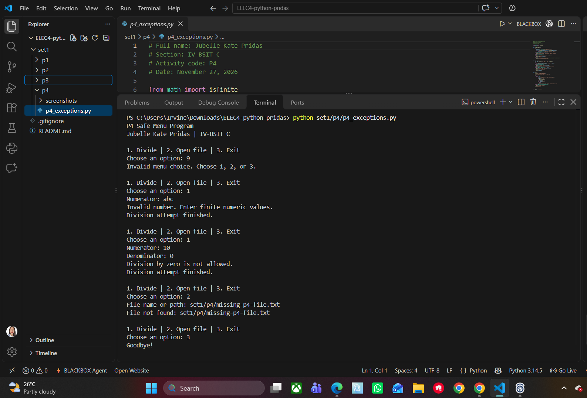

# ELEC 4 — Python Programming

- **Student:** Jubelle Kate Pridas
- **Section:** IV-BSIT C

## Set 1

| Activity | Description |
| --- | --- |
| [P1 — Student Grade Calculator](set1/p1/) | Enter grades and display the average, highest, lowest, and pass/fail status. |
| [P2 — Custom Module](set1/p2/) | Generate a timestamped grade report using the functions in `student_utils`. |
| [P3 — Student Record Manager](set1/p3/) | Manage student names with case-insensitive duplicate checks and partial search. |
| [P4 — Safe Menu Program](set1/p4/) | Divide numbers and open text files with exception handling. |

### P1 — Run from the repository root

```powershell
python set1/p1/p1_grade_calculator.py
```



### P2 — Run from the repository root

```powershell
python set1/p2/p2_main.py
```



### P3 — Run from the repository root

```powershell
python set1/p3/p3_record_manager.py
```





### P4 — Run from the repository root

```powershell
python set1/p4/p4_exceptions.py
```


